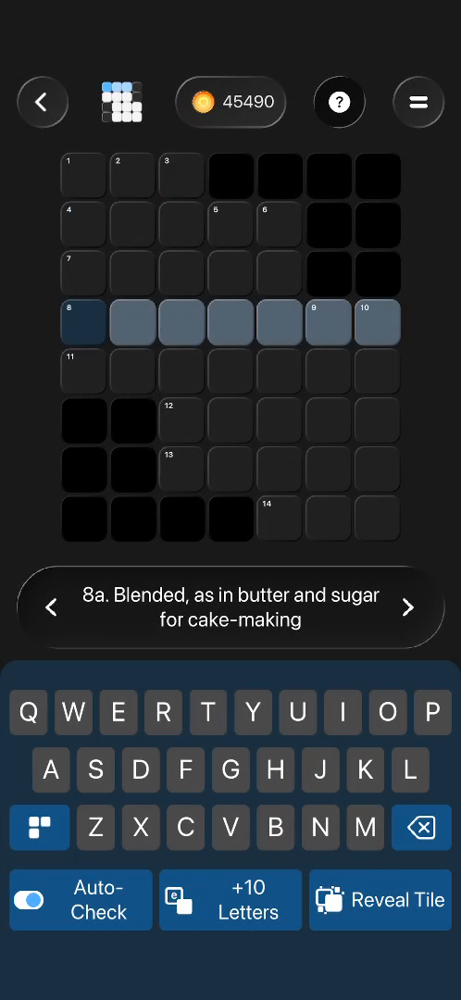
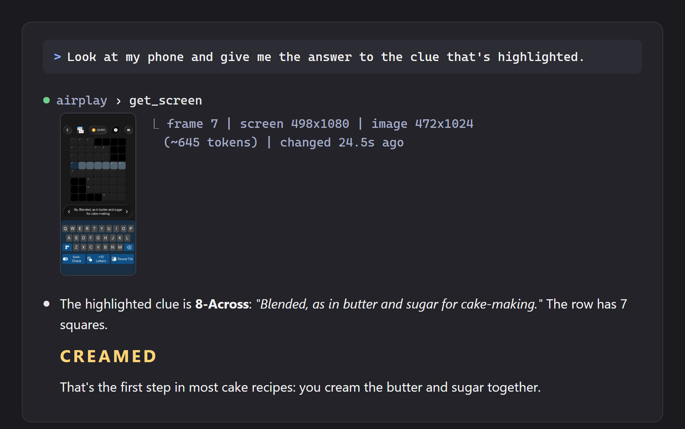

# airplay-mcp

An MCP server that turns your computer into an **AirPlay receiver** an AI agent can see through. The agent switches the receiver on, you mirror your iPhone or iPad to it, and the agent gets the phone screen frame by frame. It can look at the screen, wait for it to change, or save frames to disk for whatever processing it has been asked to do.

Works with any MCP client (Claude Code, Claude Desktop, Cursor, …). No external apps needed: the AirPlay protocol and FairPlay are handled in pure Python by the `pylibairplay` library.

## See it in action

<table>
  <tr>
    <td width="30%"></td>
    <td width="70%"></td>
  </tr>
</table>

Left: a frame captured from an iPhone mirroring a crossword app. Right: an agent calling `get_screen`, reading the highlighted clue off that frame, and answering it.

## Install as a Claude Code plugin

In Claude Code you can skip most of the manual steps below. Install the plugin:

```
/plugin install airplay-mcp --marketplace feedthedogs/airplay-mcp
```

(On Claude Code older than 2.1.275, first run `/plugin marketplace add feedthedogs/airplay-mcp`, then `/plugin install airplay-mcp@airplay-mcp`.)

The plugin works in Claude Code and other clients that run local MCP servers. It can't work from claude.ai in a browser, because the receiver has to be on the same Wi-Fi as your phone.

The same flow is published for OpenClaw as the [`airplay-screen` ClawHub skill](clawhub/airplay-screen/SKILL.md).

## Quick start

You need an iPhone or iPad, a computer (Windows, macOS or Linux) on the **same Wi-Fi** as the phone, and a couple of minutes. Allow the firewall prompt the first time it runs: the phone has to reach the receiver over TCP and mDNS (UDP 5353).

### 1. Install

First [uv](https://docs.astral.sh/uv/) (skip if you have it):

```sh
# macOS / Linux
curl -LsSf https://astral.sh/uv/install.sh | sh
```
```powershell
# Windows (PowerShell)
powershell -ExecutionPolicy ByPass -c "irm https://astral.sh/uv/install.ps1 | iex"
```

Open a new terminal, then install airplay-mcp from [PyPI](https://pypi.org/project/airplay-mcp/):

```sh
uv tool install airplay-mcp
airplay-mcp --help
```

If `airplay-mcp` isn't found, run `uv tool update-shell` and open a new terminal. Want the `read_screen_text` OCR tool too? Install `"airplay-mcp[ocr]"` instead.

### 2. Add it to your MCP client

**Claude Code**
```sh
claude mcp add airplay -- airplay-mcp
```

**Claude Desktop, Cursor and other JSON configs**
```json
{
  "mcpServers": {
    "airplay": {
      "command": "airplay-mcp"
    }
  }
}
```

If your client can't find `airplay-mcp`, put the full path in `"command"` (`which airplay-mcp` on macOS/Linux, `where airplay-mcp` on Windows). Restart the client if it was already open.

### 3. Use it

Ask your agent something like: *"Turn on the AirPlay screen, wait for my phone, and tell me the next move in this Sudoku."*

The agent starts the receiver and tells you what to do. On the phone: **Control Centre > Screen Mirroring > "AI Screen"** (enter `3939` if it asks for a code). From then on the agent can look at the screen, wait for it to change, or save frames to disk. See [How an agent uses it](#how-an-agent-uses-it).

### Troubleshooting

- **The phone doesn't list "AI Screen"**: same network? VPNs and guest Wi-Fi often block mDNS. Check the firewall allowed Python.
- **Check it outside your client**: `airplay-mcp --autostart -v` prints a log, including when the first frame arrives.
- **Test without a phone**: see [Testing without a phone](#testing-without-a-phone).

## Configuration

All settings are optional. Pass them as environment variables (the `"env"` block above, or `-e NAME=value` in `claude mcp add`) or as command-line flags. `airplay-mcp --help` lists everything.

| Env var | Flag | Default | Meaning |
|---|---|---|---|
| `AIRPLAY_NAME` | `--name` | `AI Screen` | Name the phone shows under Screen Mirroring |
| `AIRPLAY_PIN` | `--pin` | `3939` | Pairing code, if the phone asks for one |
| `AIRPLAY_SAVE_DIR` | `--save-dir` | `~/airplay-mcp` | Where `save_screen` writes files given as relative paths |
| `AIRPLAY_AUTOSTART` | `--autostart` | off | Start the receiver at launch, not when the agent calls `start_receiver` |
| `AIRPLAY_MAX_DIM` | `--max-dim` | `1024` | Default longest edge of images sent to the model |
| `AIRPLAY_TRANSPORT` | `--transport` | `stdio` | `http` serves streamable HTTP at `http://HOST:PORT/mcp` |
| `AIRPLAY_HOST` / `AIRPLAY_PORT` | `--host` / `--port` | `127.0.0.1` / `8765` | HTTP bind address (no auth, so only expose it on trusted networks) |

The tuning options (`--ignore-top`, `--min-changed-cells`, `--sample-fps`, `--quality`) rarely need changing.

## How an agent uses it

The server explains this flow to the model in its MCP instructions. A typical session:

1. **`start_receiver`**: the receiver starts advertising. The reply tells the agent what to say to the user: *"Open Control Centre → Screen Mirroring and pick 'AI Screen'"*.
2. **`wait_for_change`**: blocks until the first frame arrives, and afterwards until the screen next changes. Returns text only.
3. **`get_screen`** to look at the screen, or **`save_screen`** to write a full-resolution PNG/JPEG to disk for scripts and other tools. `save_screen` returns only the file path, so it costs almost no tokens.
4. Repeat steps 2 and 3 as the user works on the phone.
5. **`stop_receiver`** when finished.

Example prompts:

- *"Turn on the AirPlay screen, wait for my phone, and tell me the next move in this Sudoku."*
- *"Look at the crossword on my phone and solve the highlighted clue."*
- *"Start AirPlay and save a screenshot to ./shots every time my screen changes, until I say stop."*
- *"I'm going to scroll through a long article on my phone. Read along and summarise it when I'm done."*

### Tools

| Tool | What it does |
|---|---|
| `start_receiver()` / `stop_receiver()` | Switch the AirPlay receiver on or off. Both are safe to repeat |
| `screen_status()` | Text only: receiver on/off, device connected, resolution, frame number, time since the last change |
| `wait_for_change(timeout_s, since_frame)` | Block until the first frame or the next real change (the status-bar clock is ignored) |
| `get_screen(mode, max_dim, region, since_frame, force, settle_ms, grid, format)` | The screen as an image, with a one-line header |
| `save_screen(path, region, max_dim)` | Write the screen to an image file |
| `read_screen_text(region)` | OCR text with positions (needs the `ocr` extra) |
| resource `airplay://screen/latest` | The latest frame as a JPEG, with update notifications |

### Keeping token use down

- `get_screen` always returns the current frame (the last one received if the screen is static). Pass `since_frame=12` to get `unchanged: still frame 12` (about 15 tokens) instead of a repeat image.
- `mode="changes"` sends only the area that changed. A typed digit costs about 90 tokens instead of about 650.
- Letterbox bars are cropped and the status bar is ignored for change detection.
- `region=[x,y,w,h]` zooms in on detail, `max_dim=512` gives a quick glance, and `grid=[9,9]` overlays labelled cells so the model can say "E5".
- Captures wait for animations to settle, so the model isn't sent a blurred mid-transition frame.

Dedupe is tracked per client connection. Stateless HTTP clients get a new connection on every request, so they should pass `since_frame` explicitly.

## Testing without a phone

`--receiver external` (or `--external`, `AIRPLAY_EXTERNAL=1`) skips AirPlay and accepts a raw Annex-B H.264 stream. `start_receiver` reports the port:

```sh
ffmpeg -re -i clip.mp4 -an -c:v libx264 -f h264 tcp://127.0.0.1:<port>
```

## Privacy and support

Everything runs locally. Frames stay in memory on your computer and reach your AI client only when the agent asks for them, and nothing is uploaded by airplay-mcp itself. See [PRIVACY.md](PRIVACY.md). Report bugs and ask questions in [GitHub issues](https://github.com/feedthedogs/airplay-mcp/issues).

## Development

```sh
git clone https://github.com/feedthedogs/airplay-mcp && cd airplay-mcp
uv sync
uv run pytest
npx @modelcontextprotocol/inspector uv run airplay-mcp --external
```

```
iPhone --AirPlay--> pylibairplay receiver --Annex-B H.264 over local TCP--> PyAV decoder
                                                                          |
                                     MCP tools / resource  <--  FrameStore + change detection
```

The receiver is a pluggable interface (`receivers/base.py`; `native.py` implements it). Android has no practical equivalent: Google certifies Cast receivers, so scrcpy (over ADB) or Miracast are the realistic routes.
